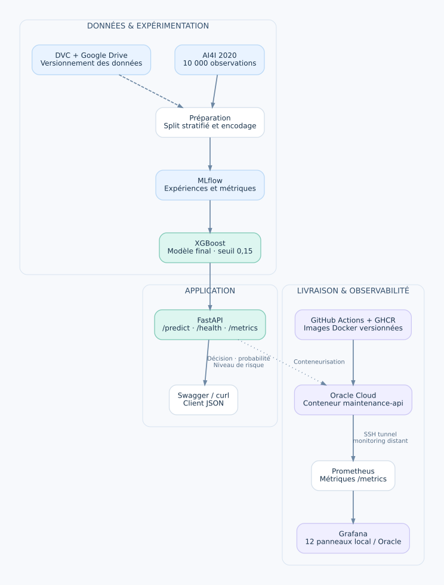
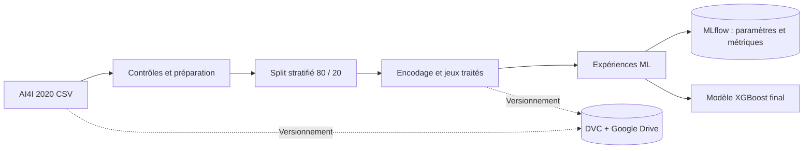
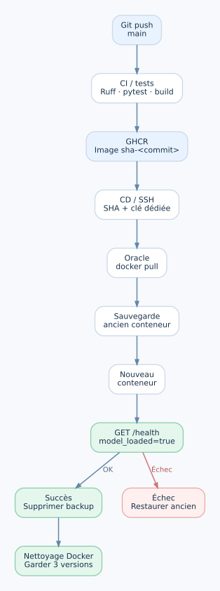
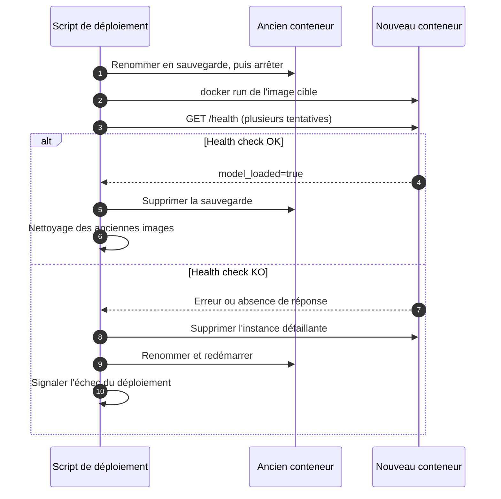
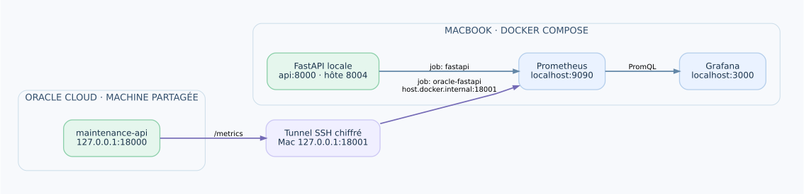
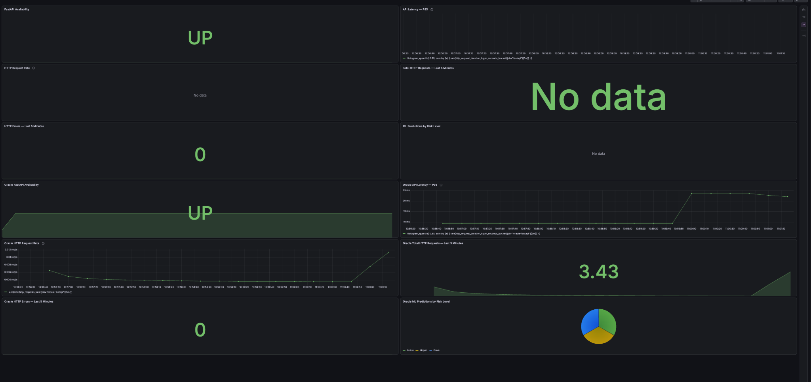
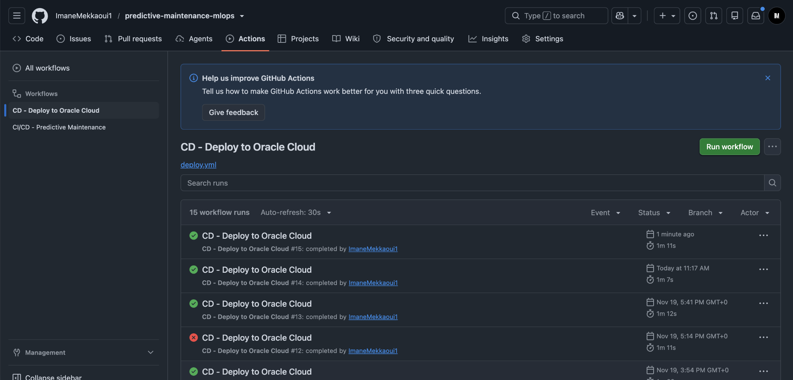
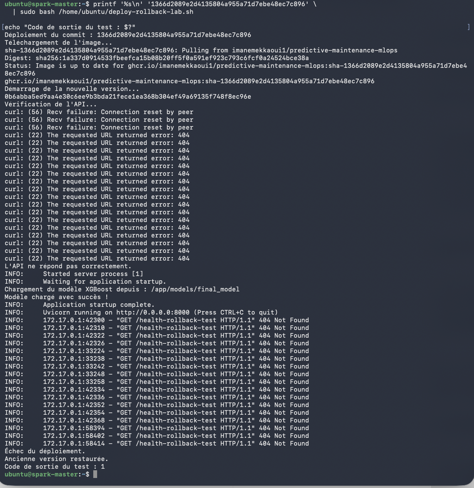
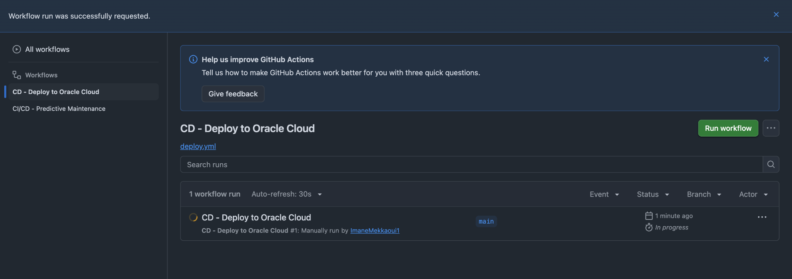

<div align="center">

# Predictive Maintenance — Industrial MLOps

**De la classification des défaillances industrielles à une API déployée, surveillée et restaurable**

**Master SDIA — ENSET Mohammedia | Projet de fin de module DevOps / MLOps | 2026–2027**

[](https://github.com/ImaneMekkaoui1/predictive-maintenance-mlops/actions/workflows/ci.yml)
[](https://github.com/ImaneMekkaoui1/predictive-maintenance-mlops/actions/workflows/deploy.yml)


**Équipe :** Imane Mekkaoui · Yazid Essoktani · Ahmed Douyry  
**Encadrant :** Pr. Soufiane HAMIDA  
**Dépôt :** [ImaneMekkaoui1/predictive-maintenance-mlops](https://github.com/ImaneMekkaoui1/predictive-maintenance-mlops)

</div>

---

## Présentation du projet

Ce projet implémente une solution **MLOps de maintenance prédictive industrielle** fondée sur le jeu de données **AI4I 2020**. Un modèle **XGBoost** analyse des mesures de fonctionnement de machines pour déterminer si une défaillance est associée à l'observation, produire une probabilité et attribuer un niveau de risque. Le modèle est servi par **FastAPI**, conteneurisé avec **Docker**, publié dans **GitHub Container Registry (GHCR)** et déployé automatiquement sur **Oracle Cloud** après validation de la CI.

Le périmètre comprend aussi le versionnement des données (**DVC + Google Drive**), le suivi des expériences (**MLflow**), la qualité logicielle (**Ruff, pytest**), la supervision (**Prometheus, Grafana**), le **rollback automatique** et la rétention contrôlée des images Docker.

| Dimension | Implémentation |
|---|---|
| Problème métier | Classification binaire de défaillance machine |
| Résultats | Décision Oui/Non, probabilité, niveau Faible/Moyen/Élevé |
| Données | AI4I 2020, 10 000 observations, 3,39 % de pannes |
| Modèle en production | XGBoost, seuil de décision `0.15` |
| Interface | FastAPI : `/predict`, `/health`, `/metrics`, `/docs` |
| Livraison | GitHub Actions CI/CD, Docker multi-architecture, GHCR, Oracle Cloud |
| Exploitation | Monitoring local et distant, rollback testé, nettoyage Docker automatique |

> **Limite du périmètre :** le modèle prédit un état de défaillance à partir d'une observation. Il ne prédit ni la date de la prochaine panne, ni la **Remaining Useful Life (RUL)**. Les probabilités proviennent du modèle et ne doivent pas être assimilées à des garanties de fiabilité ou à une calibration probabiliste démontrée.

### Sommaire

1. [Architecture globale](#architecture-globale)
2. [Données, préparation et DVC](#données-préparation-et-dvc)
3. [Modélisation et résultats](#modélisation-et-résultats)
4. [API et démarrage rapide](#api-et-démarrage-rapide)
5. [Pipeline CI/CD et Oracle Cloud](#pipeline-cicd-et-oracle-cloud)
6. [Rollback et gestion des images](#rollback-et-gestion-des-images)
7. [Monitoring Prometheus et Grafana](#monitoring-prometheus-et-grafana)
8. [Captures et preuves d'exécution](#captures-et-preuves-dexécution)
9. [Structure du dépôt](#structure-du-dépôt)
10. [Reproductibilité, sécurité et limites](#reproductibilité-sécurité-et-limites)

---

## Architecture globale



**Lecture de l'architecture :**

- **Cycle de vie des données :** AI4I 2020 est préparé et versionné avec DVC ; les artefacts volumineux résident dans un remote Google Drive autorisé.
- **Cycle de vie du modèle :** les expérimentations comparent plusieurs modèles et variantes ; MLflow conserve les métriques et artefacts dans le tracking store configuré.
- **Cycle de vie logiciel :** FastAPI charge le modèle final ; GitHub Actions construit puis publie une image Docker traçable par SHA Git.
- **Exploitation :** Oracle Cloud héberge l'API ; Prometheus collecte des métriques et Grafana les affiche dans un dashboard à 12 panneaux.

Sources éditables des illustrations : [`docs/diagrams/`](docs/diagrams/). Les fichiers `.svg` sont des rendus vectoriels intégrés directement à ce README.

## Données, préparation et DVC

### Dataset AI4I 2020

**Source :** [UCI Machine Learning Repository — AI4I 2020 Predictive Maintenance Dataset](https://archive.ics.uci.edu/dataset/601/ai4i+2020+predictive+maintenance+dataset).

| Groupe | Colonnes / utilisation |
|---|---|
| Cible | `Machine failure` : 0 = fonctionnement normal, 1 = défaillance |
| Caractéristiques | `Type`, `Air temperature [K]`, `Process temperature [K]`, `Rotational speed [rpm]`, `Torque [Nm]`, `Tool wear [min]` |
| Identifiants exclus | `UDI`, `Product ID` |
| Indicateurs de défaillance exclus | `TWF`, `HDF`, `PWF`, `OSF`, `RNF` pour éviter une fuite d'information par rapport à la cible |
| Découpage | 80 % entraînement / 20 % test ; stratification ; `random_state=42` |
| Prétraitement | Encodage One-Hot de `Type` et alignement des variables avec l'API |

Le dataset contient **9 661 observations normales (96,61 %)** et **339 observations de défaillance (3,39 %)**. Cette distribution impose une évaluation centrée notamment sur la **précision**, le **rappel**, le **F1-score** et la **PR-AUC**, plutôt que sur l'accuracy seule.

### Pipeline de données



Le stage `prepare` du fichier [`dvc.yaml`](dvc.yaml) couvre la préparation du dataset. Les étapes d'entraînement, de publication et de déploiement ne sont **pas** présentées comme des stages DVC : elles sont réalisées par les scripts/notebooks ML et les workflows GitHub Actions correspondants.

Pour récupérer les fichiers suivis par DVC, une fois les permissions Google Drive obtenues :

```bash
python3.12 -m venv .venv
source .venv/bin/activate
python -m pip install -r requirements.txt
python -m pip install 'dvc[gdrive]'
dvc remote list
dvc pull
dvc repro
```

**Règle de versionnement :** les fichiers volumineux restent hors de Git ; on synchronise les données avec `dvc push`, puis on commite dans Git les fichiers `.dvc`, `dvc.yaml` ou `dvc.lock` réellement modifiés. Aucun identifiant OAuth ni secret Google Drive ne doit être commité.

## Modélisation et résultats

### Stratégie expérimentale

Le travail a comparé **Decision Tree**, **Random Forest** et **XGBoost**, avec une attention particulière aux données déséquilibrées : modèles de base, pondération des classes et variantes utilisant **SMOTE** sur les données d'entraînement uniquement. Le modèle XGBoost a été retenu pour le service final, après comparaison et optimisation du seuil de décision.

Les expériences sont suivies dans **MLflow**. Les résultats du modèle final consignés dans le rapport d'équipe sont :

| Métrique sur le jeu de test | Valeur |
|---|---:|
| Précision | **62,92 %** |
| Rappel | **82,35 %** |
| F1-score | **71,34 %** |
| ROC-AUC | **97,64 %** |
| PR-AUC | **84,89 %** |

*Ces chiffres correspondent aux résultats documentés par l'équipe ; ils ne sont pas issus d'un nouvel entraînement effectué lors de la rédaction de ce README. Les exports des runs MLflow constituent les éléments de vérification recommandés.*

### Décision et niveau de risque

L'API transforme la probabilité `p` fournie par XGBoost en trois sorties :

| Condition | Prédiction binaire | Niveau de risque |
|---|---|---|
| `p < 0.15` | 0 — Pas de défaillance | Faible |
| `0.15 ≤ p < 0.50` | 1 — Défaillance | Moyen |
| `p ≥ 0.50` | 1 — Défaillance | Élevé |

Le niveau de risque est **une règle métier construite sur la probabilité du classifieur**, et non un modèle de régression supplémentaire.

### Exemples réellement testés sur Oracle

| Exemple | Probabilité retournée | Prédiction | Risque |
|---|---:|---|---|
| Fonctionnement à faible risque | `0.1352` | 0 | Faible |
| Fonctionnement à risque moyen | `0.4990` | 1 | Moyen |
| Fonctionnement à risque élevé | `0.9861` | 1 | Élevé |

Les trois prédictions ont été comptabilisées dans `maintenance_predictions_total` puis observées sur le dashboard Grafana Oracle.

## API et démarrage rapide

### Prérequis

- Git et Docker Engine / Docker Desktop avec Docker Compose.
- Pour le mode Python : Python 3.12 et les dépendances de `requirements-api.txt`.
- Pour reproduire les expériences : accès au remote DVC et environnement ML.

### Option A — Démarrage via Docker Compose

```bash
git clone https://github.com/ImaneMekkaoui1/predictive-maintenance-mlops.git
cd predictive-maintenance-mlops
docker compose up -d --build
curl -fsS http://127.0.0.1:8000/health
```

Réponse attendue :

```json
{"status":"healthy","model_loaded":true}
```

Documentation Swagger : [`http://127.0.0.1:8000/docs`](http://127.0.0.1:8000/docs). Arrêt : `docker compose down`.

Le modèle exporté dans `models/final_model/` est chargé au démarrage de l'API. Pour **tester uniquement l'inférence**, il n'est pas nécessaire de télécharger préalablement toutes les données DVC.

### Option B — Développement local sans Docker

```bash
python3.12 -m venv .venv
source .venv/bin/activate
python -m pip install -r requirements-api.txt
PYTHONPATH=src uvicorn predictive_maintenance.api.main:app --reload
```

### Endpoints

| Méthode | Route | Utilisation |
|---|---|---|
| `GET` | `/` | Présentation du service |
| `GET` | `/health` | État de l'API et chargement du modèle |
| `POST` | `/predict` | Inférence à partir des capteurs |
| `GET` | `/docs` | Interface Swagger/OpenAPI |
| `GET` | `/metrics` | Métriques au format Prometheus |

### Exemple de requête

```bash
curl -fsS -X POST http://127.0.0.1:8000/predict \
  -H 'Content-Type: application/json' \
  -d '{
    "type": "L",
    "air_temperature_k": 300.5,
    "process_temperature_k": 310.0,
    "rotational_speed_rpm": 1345,
    "torque_nm": 62.7,
    "tool_wear_min": 153
  }'
```

Réponse observée avec le modèle déployé :

```json
{
  "prediction": 0,
  "failure_detected": false,
  "failure_probability": 0.1352,
  "risk_level": "Faible",
  "threshold": 0.15
}
```

Les champs utilisent des unités industrielles cohérentes avec le dataset (kelvins, tr/min, newton-mètres, minutes). L'API applique les validations de schéma prévues dans les modèles Pydantic.

### Qualité et tests

```bash
python -m pip install -r requirements-api.txt
python -m pip install pytest ruff
ruff check src tests
PYTHONPATH=src pytest -v
docker compose build
```

## Pipeline CI/CD et Oracle Cloud



### Intégration continue — `.github/workflows/ci.yml`

Sur un `push` ou une pull request visant `main`, la CI :

1. Prépare **Python 3.12** et installe les dépendances.
2. Vérifie la qualité du code avec **Ruff**.
3. Exécute les tests automatisés avec **pytest**.
4. Construit une image Docker de validation.
5. Après un `push` validé, publie une image multi-architecture **`linux/amd64` et `linux/arm64`** sur **GHCR**.

Les images publiées disposent du tag `latest` et d'un tag associé au **SHA Git de 40 caractères**, par exemple :

```text
ghcr.io/imanemekkaoui1/predictive-maintenance-mlops:sha-5faeb5405aab5415944ce1538cd8ab50acf312f8
```

### Déploiement continu — `.github/workflows/deploy.yml`

Le workflow CD est déclenchable manuellement (`workflow_dispatch`) ou automatiquement après une exécution CI réussie provenant d'un push sur `main` (`workflow_run`). Le job récupère le SHA à déployer et le transmet via **SSH avec vérification de la clé de l'hôte** au script root installé sur Oracle.

Le script versionné [`scripts/deploy.sh`](scripts/deploy.sh) réalise :

1. Validation du format du SHA et verrouillage des déploiements concurrents.
2. `docker pull` de l'image GHCR correspondant au commit.
3. Renommage et arrêt de l'ancien conteneur pour constituer une sauvegarde temporaire.
4. Démarrage de `maintenance-api` avec limites **1 CPU / 2 Gio de RAM**.
5. Vérifications répétées de `GET /health` avec `model_loaded=true`.
6. En cas de réussite : retrait de la sauvegarde ; en cas d'échec : restauration de l'ancien conteneur.
7. Après réussite uniquement : appel du script de nettoyage Docker.

Le conteneur écoute sur le port **`127.0.0.1:18000` côté Oracle**, non publiquement. Les secrets GitHub utilisés par le CD sont `ORACLE_HOST`, `ORACLE_USER`, `ORACLE_SSH_KEY` et `ORACLE_KNOWN_HOSTS` ; leurs valeurs ne figurent pas dans ce dépôt.

> **Déploiement reproductible :** `scripts/deploy.sh` et `scripts/cleanup_docker_images.sh` sont versionnés. Leur copie dans `/opt/predictive-maintenance/` sur Oracle reste une **opération d'administration explicite** ; le workflow CD courant exécute le script installé, sans synchroniser automatiquement les modifications de ces fichiers.

### Déploiements de référence

- [CI/CD #20 — tests et publication de l'image du commit `5faeb54`](https://github.com/ImaneMekkaoui1/predictive-maintenance-mlops/actions/runs/44902713425).
- [Historique des déploiements Oracle — workflow CD](https://github.com/ImaneMekkaoui1/predictive-maintenance-mlops/actions/workflows/deploy.yml).
- Déploiement validé sur Oracle : image `sha-5faeb5405aab5415944ce1538cd8ab50acf312f8`, API `healthy`, modèle chargé.

## Rollback et gestion des images

### Retour automatique à la version précédente



**Test réalisé en environnement isolé sur Oracle :** un conteneur `maintenance-api-rollback-lab` a été exposé uniquement sur `127.0.0.1:18002`. Un health check volontairement invalide (`/health-rollback-test`) a provoqué des réponses HTTP 404 et le déclenchement du rollback. L'identifiant Docker de l'ancien conteneur a été retrouvé **identique avant et après** ; les ports `18002` (laboratoire) et `18000` (production) ont répondu `healthy`. Le conteneur de laboratoire a ensuite été supprimé.

Ce résultat valide **le scénario de restauration testé**, mais ne remplace pas des tests de résilience plus larges (panne disque, perte réseau, corruption d'image, etc.).

### Politique de conservation Docker

Le script [`scripts/cleanup_docker_images.sh`](scripts/cleanup_docker_images.sh) est appelé **après un déploiement réussi**. Il prend en charge un mode `--dry-run`, vérifie que la production est active, refuse d'agir si une sauvegarde de rollback est encore présente et ne cible que les images du projet.

Politique : conserver **l'image active et deux autres tags SHA récents** ; le tag `latest` n'est pas ciblé. Les images d'autres applications et les volumes ne sont pas supprimés. Les couches Docker étant partagées, le nombre de tags ne correspond pas directement à l'espace consommé.

Dernière vérification Oracle documentée (21 novembre 2026) : **45 Go de disque, 35 Go utilisés, environ 10 Go disponibles (78 %)**, avec les tags SHA `5faeb54`, `1366d20` et `04f7375` présents.

## Monitoring Prometheus et Grafana



La supervision repose sur les instruments HTTP de FastAPI et un compteur métier :

- Métriques HTTP : disponibilité de la cible, débit des requêtes, latence P95 et erreurs 4xx/5xx.
- Métrique métier : `maintenance_predictions_total{prediction="...",risk_level="..."}`.
- Deux jobs Prometheus : `fastapi` pour l'API locale et `oracle-fastapi` pour Oracle.

### Démarrer l'environnement de supervision local

Le fichier [`monitoring/docker-compose.yml`](monitoring/docker-compose.yml) définit l'API locale, Prometheus et Grafana. `monitoring/.env` doit être créé localement avec la configuration Grafana attendue (par exemple `GF_SECURITY_ADMIN_USER` et `GF_SECURITY_ADMIN_PASSWORD`) et ne doit pas être commité.

```bash
docker compose -f monitoring/docker-compose.yml up -d --build
docker compose -f monitoring/docker-compose.yml ps
```

| Interface | Adresse locale |
|---|---|
| API locale supervisée | `http://127.0.0.1:8004` |
| Prometheus | `http://127.0.0.1:9090` |
| Grafana | `http://127.0.0.1:3000` |

### Supervision distante via tunnel SSH

L'API Oracle n'expose pas directement son port de production sur Internet. Depuis un MacBook disposant d'un accès SSH autorisé, établir le tunnel :

```bash
ssh -i /chemin/vers/cle-oracle \
  -N -o ServerAliveInterval=30 -o ServerAliveCountMax=3 \
  -L 127.0.0.1:18001:127.0.0.1:18000 \
  ubuntu@HOTE_ORACLE
```

L'URL `http://127.0.0.1:18001/metrics` représente alors les métriques de l'API Oracle. Prometheus interroge `host.docker.internal:18001` dans le job `oracle-fastapi`.

> **Attention :** le tunnel SSH est lié à une session active sur le MacBook. Si cette session se ferme, la cible Prometheus `oracle-fastapi` peut afficher **DOWN**, même si l'API Oracle est parfaitement saine. Ce monitoring distant est adapté à une démonstration encadrée ; une collecte autonome sur infrastructure dédiée serait préférable pour une exploitation permanente.

### Dashboard à 12 panneaux

Les douze visualisations sont organisées en deux ensembles : six indicateurs pour l'API locale et les six mêmes indicateurs pour Oracle.

| Indicateur | Local | Oracle |
|---|---|---|
| Disponibilité FastAPI | Oui | Oui |
| Latence HTTP P95 | Oui | Oui |
| Débit HTTP (requests/s) | Oui | Oui |
| Requêtes sur les 5 dernières minutes | Oui | Oui |
| Erreurs HTTP sur les 5 dernières minutes | Oui | Oui |
| Prédictions par niveau de risque | Oui | Oui |

Le dashboard et la datasource sont provisionnés depuis [`monitoring/grafana/`](monitoring/grafana/). Le graphique de répartition Oracle a été vérifié avec **une prédiction de chaque niveau** : Faible, Moyen et Élevé.



## Captures et preuves d'exécution

Toutes les captures présentées ici proviennent des étapes réelles du projet, et non d'illustrations fictives. Elles sont incluses dans `docs/assets/`.

<details>
<summary><strong>GitHub Actions : exécutions CD terminées avec succès</strong></summary>



</details>

<details>
<summary><strong>GitHub Actions : journal d'un déploiement Oracle réussi</strong></summary>


</details>

<details>
<summary><strong>Test de rollback : erreur volontaire et restauration confirmée</strong></summary>



Le test a également confirmé l'égalité des identifiants Docker avant/après la restauration, puis la réponse `healthy` de l'API de test et de la production.

</details>

<details>
<summary><strong>Déclenchement manuel du workflow CD</strong></summary>



</details>

<details>
<summary><strong>Configuration des secrets GitHub, sans exposer leurs valeurs</strong></summary>


</details>

## Structure du dépôt

```text
predictive-maintenance-mlops/
├── .github/workflows/
│   ├── ci.yml                        # Tests, qualité, build et publication GHCR
│   └── deploy.yml                    # Déploiement Oracle après CI
├── .dvc/                              # Configuration du remote DVC
├── data/
│   ├── raw/                          # Dataset suivi par DVC
│   └── processed/                    # Jeux préparés
├── docs/
│   ├── assets/                       # Captures et schémas pour le README
│   ├── diagrams/                     # Sources Graphviz des architectures
│   ├── guide-exploitation.md         # Exploitation et vérifications
│   └── historique-projet.md          # Parcours du projet
├── models/final_model/               # Artefact XGBoost exporté
├── monitoring/
│   ├── docker-compose.yml            # API, Prometheus, Grafana
│   ├── prometheus.yml                # Jobs fastapi / oracle-fastapi
│   └── grafana/                      # Datasource, dashboard et provisioning
├── notebooks/                        # Exploration, entraînement et comparaison
├── reports/                          # Résultats et rapports du projet
├── scripts/
│   ├── deploy.sh                     # Déploiement avec health check et rollback
│   └── cleanup_docker_images.sh      # Conservation contrôlée des images
├── src/predictive_maintenance/
│   ├── data/prepare.py
│   └── api/main.py
├── tests/                             # Tests pytest
├── dvc.yaml
├── dvc.lock
├── Dockerfile
├── docker-compose.yml
├── requirements-api.txt
└── README.md
```

Cette arborescence présente les éléments utiles à la compréhension ; elle n'inclut pas les répertoires temporaires, caches locaux, historiques MLflow ignorés et secrets.

## Reproductibilité, sécurité et limites

### Ce qui est reproductible depuis Git

- Code source, configuration de la CI/CD, scripts de déploiement, documentation, images du README et configuration du monitoring.
- Artefact final de prédiction déjà utilisé par Docker, dans `models/final_model/`.
- Métadonnées DVC ; les datasets doivent être récupérés séparément avec les droits Google Drive nécessaires.

### Points de sécurité

- Les valeurs des secrets GitHub, clés SSH, tokens OAuth et mots de passe Grafana ne doivent pas être commitées.
- L'API Oracle est publiée uniquement sur `127.0.0.1:18000` ; l'accès distant d'administration et de démonstration utilise SSH.
- Le compte CD dispose d'une autorisation limitée pour exécuter le script de déploiement. Le script est installé avec des permissions d'administration sur Oracle.
- Le nettoyage Docker ne cible pas les images Hadoop, les volumes ni les autres applications.
- Le déploiement manuel doit être utilisé avec précaution : une invocation manuelle n'implique pas nécessairement une CI réussie pour le SHA choisi.

### Limites et pistes d'amélioration

- Évaluer la **calibration** des probabilités et tester la robustesse face à de nouvelles conditions industrielles.
- Installer une collecte distante continue, indépendante d'un tunnel SSH ouvert depuis le Mac.
- Ajouter des alertes et des contrôles de **dérive de données / de modèle** ; le monitoring actuel porte principalement sur la disponibilité, le trafic et les prédictions.
- Renforcer le processus de promotion des modèles et synchroniser de manière contrôlée les scripts versionnés avec ceux installés sur Oracle.
- Éviter les reconstructions d'images lors de modifications purement documentaires, en affinant les déclencheurs de workflow après validation avec l'équipe.
- Étudier la prédiction du RUL avec un dataset adapté dans un travail distinct.

Pour les vérifications de production et les commandes de diagnostic, consulter le [guide d'exploitation](docs/guide-exploitation.md). Pour le suivi chronologique du travail, voir l'[historique du projet](docs/historique-projet.md).

---

<div align="center">

**Predictive Maintenance — MLOps**  
**ENSET Mohammedia | Master SDIA | 2026–2027**  
*Données versionnées. Modèle suivi. API testée. Déploiement automatisé. Exploitation observable.*

</div>
