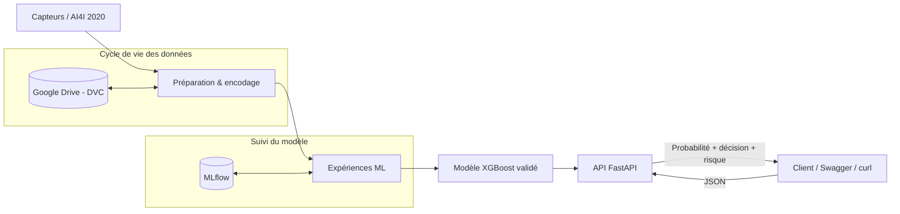
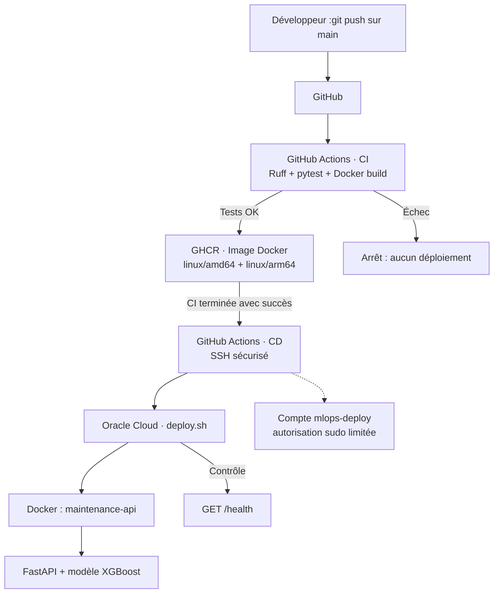
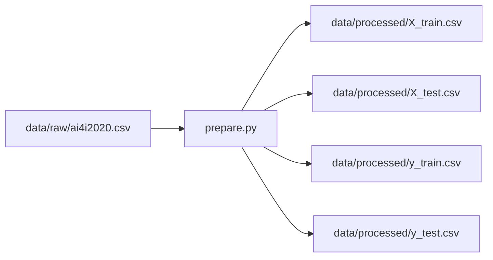
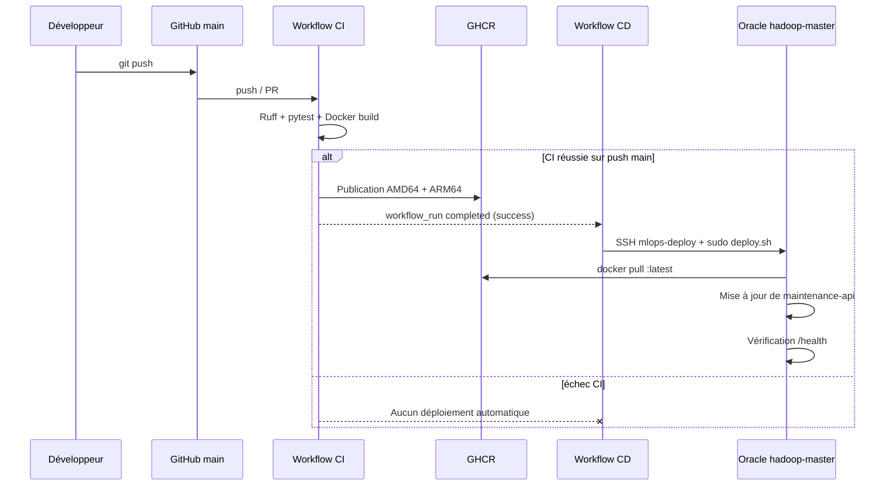
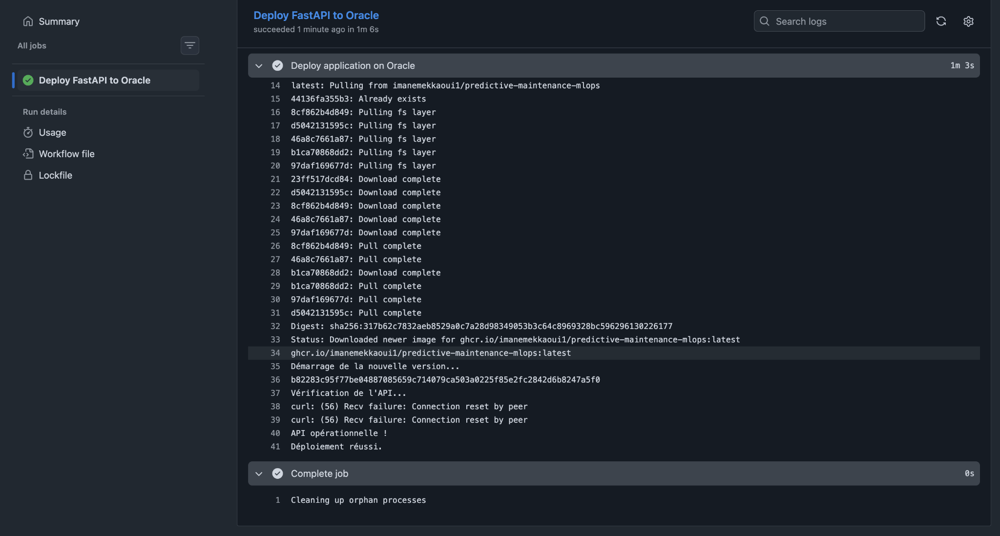
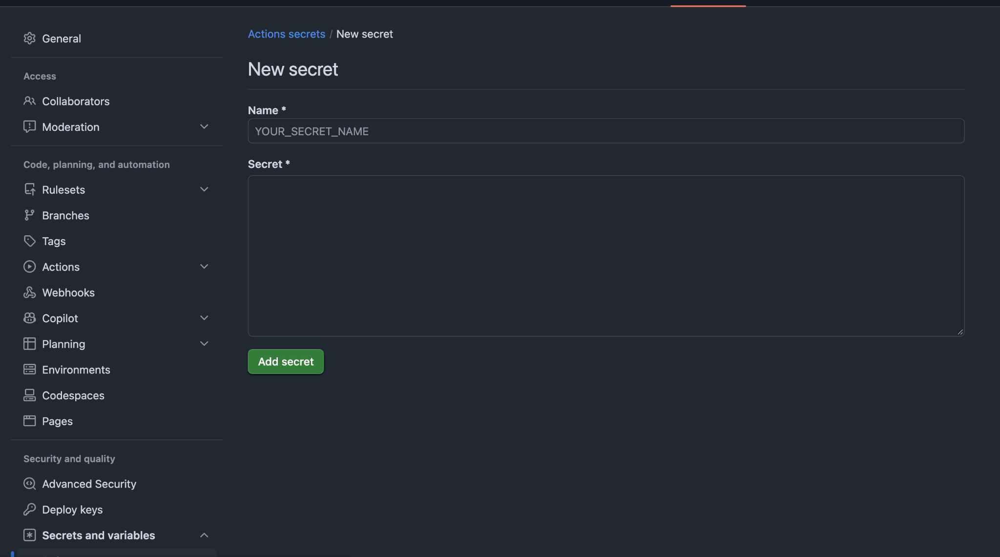

<div align="center">

# 🏭 Predictive Maintenance — MLOps

### De la détection de pannes industrielles au déploiement continu sur Oracle Cloud

**Master SDIA · ENSET Mohammedia · Projet de fin de module DevOps / MLOps**

[](https://github.com/ImaneMekkaoui1/predictive-maintenance-mlops/actions/workflows/ci.yml)
[](https://github.com/ImaneMekkaoui1/predictive-maintenance-mlops/actions/workflows/deploy.yml)


**Équipe :** Imane Mekkaoui · Yazid Essoktani · Ahmed Douyry  
**Encadrant :** Pr. Soufiane HAMIDA  
**Dépôt :** [ImaneMekkaoui1/predictive-maintenance-mlops](https://github.com/ImaneMekkaoui1/predictive-maintenance-mlops)

[⚡ Démarrage rapide](#-démarrage-rapide) · [📦 DVC & Google Drive](#-partage-des-données-avec-dvc-et-google-drive) · [🧪 API](#-exécuter-et-tester-lapi) · [🔁 CI/CD](#-pipeline-cicd) · [📘 Parcours complet](#-historique-du-projet--30-étapes)

</div>

---

> [!IMPORTANT]
> **Deux façons d'utiliser le projet.** Pour tester immédiatement les prédictions, il suffit de cloner le dépôt puis de lancer **Docker Compose** : le modèle final est déjà inclus dans `models/final_model/`. Pour **reproduire la préparation des données et les expériences ML**, il faut également configurer DVC et accéder au dossier Google Drive partagé. Ces deux parcours sont indépendants.

## 🎯 Vue d'ensemble

Ce projet propose un système de **maintenance prédictive industrielle** fondé sur le jeu de données **AI4I 2020** (10 000 observations). Les mesures de fonctionnement d'une machine sont envoyées à une API **FastAPI** qui charge un modèle **XGBoost** et retourne trois informations :

| Sortie de l'API | Exemple | Principe |
|---|---|---|
| Défaillance prédite | `Non` | Classification binaire (0 / 1) |
| Probabilité estimée | `0.06 %` | Probabilité fournie par le modèle |
| Niveau de risque | `Faible` | Règle métier fondée sur des seuils |

**Périmètre :** le jeu AI4I 2020 permet ici de prédire l'existence d'une défaillance, **pas** la durée restante avant la panne (*RUL — Remaining Useful Life*).

### 🧭 Architecture fonctionnelle



### 🔄 Architecture MLOps : du code au serveur



> [!NOTE]
> Le déploiement existant utilise encore le tag d'image **`latest`**. L'ajout de tags immuables par SHA Git et l'épreuve du rollback sont **prévus**, pas encore réalisés dans l'état documenté ici (commit `4cd83ac`, 16 novembre 2026).

## 📚 Sommaire

1. [Démarrage rapide](#-démarrage-rapide)
2. [Installer et exécuter sans Docker](#-exécuter-et-tester-lapi)
3. [Données, DVC et Google Drive](#-partage-des-données-avec-dvc-et-google-drive)
4. [Modèles et résultats](#-modélisation-et-comparaison)
5. [Structure du dépôt](#-structure-du-dépôt)
6. [Historique du projet : 30 étapes](#-historique-du-projet--30-étapes)
7. [Pipeline CI/CD et Oracle Cloud](#-pipeline-cicd)
8. [Tests et dépannage](#-tests-qualité-et-dépannage)
9. [Contribution en équipe](#-contribuer-au-projet-en-équipe)
10. [Statut et améliorations](#-état-actuel-et-prochaines-améliorations)

---

## ⚡ Démarrage rapide

### Option A — Tester l'API en 3 commandes (recommandée)

**Prérequis :** Git, Docker Desktop / Docker Engine, et le plugin `docker compose` en fonctionnement.

```bash
# 1. Télécharger le code
git clone https://github.com/ImaneMekkaoui1/predictive-maintenance-mlops.git
cd predictive-maintenance-mlops

# 2. Construire et démarrer l'API
docker compose up -d --build

# 3. Vérifier que le modèle est chargé
curl http://localhost:8000/health
```

Réponse attendue :

```json
{"status":"healthy","model_loaded":true}
```

- **Swagger UI :** <http://localhost:8000/docs>
- **Contrôle des conteneurs :** `docker compose ps`
- **Logs :** `docker compose logs -f api`
- **Arrêt :** `docker compose down`

> [!TIP]
> **Aucun `dvc pull` n'est requis pour ce parcours** : le Dockerfile copie `src/` et `models/final_model/`, tous deux présents dans le dépôt Git. Le téléchargement DVC sert à retrouver les **données expérimentales**.

### Option B — Utiliser l'image préconstruite depuis GitHub Container Registry

Si Docker est installé et que le package GHCR est accessible à votre compte :

```bash
# Télécharger l'image publiée par le workflow CI
docker pull ghcr.io/imanemekkaoui1/predictive-maintenance-mlops:latest

# Sur un ordinateur libre sur le port 8000
docker run -d --name maintenance-demo -p 8000:8000 \
   ghcr.io/imanemekkaoui1/predictive-maintenance-mlops:latest

curl http://localhost:8000/health
```

Nettoyage : `docker rm -f maintenance-demo`.

Le package est construit pour **`linux/amd64` et `linux/arm64`**. Si le registre renvoie `denied`, vérifier la visibilité du package ou l'authentification GitHub. Si le port 8000 est déjà occupé, remplacer `-p 8000:8000` par `-p 8001:8000`, puis utiliser `http://localhost:8001`.

---

## 🧪 Exécuter et tester l'API

### Installation locale avec Python 3.12

Cette voie est utile pour développer et lancer les tests, sans utiliser Docker :

```bash
# À partir de la racine du dépôt
python3.12 -m venv .venv
source .venv/bin/activate          # macOS / Linux
# Windows PowerShell : .venv\Scripts\Activate.ps1

python -mpip install --upgrade pip
pip install -r requirements-api.txt

PYTHONPATH=src uvicorn predictive_maintenance.api.main:app --reload
```

Pour Windows PowerShell, utiliser à la place de la dernière ligne :

```powershell
$env:PYTHONPATH="src"
uvicorn predictive_maintenance.api.main:app --reload
```

**Endpoints disponibles :**

| Méthode | Endpoint | Usage |
|---|---|---|
| GET | `/` | Présentation de l'API |
| GET | `/health` | État et chargement du modèle |
| POST | `/predict` | Prédiction industrielle |
| GET | `/docs` | Interface Swagger interactive |

### Exemple d'une prédiction réelle

```bash
curl -X POST http://localhost:8000/predict \
  -H "Content-Type: application/json" \
  -d '{
    "type": "M",
    "air_temperature_k": 300,
    "process_temperature_k": 310,
    "rotational_speed_rpm": 1500,
    "torque_nm": 40,
    "tool_wear_min": 100
  }'
```

Réponse observée lors des tests du projet (les résultats varient si le modèle change) :

```json
{
  "prediction": 0,
  "failure_detected": false,
  "failure_probability": 0.0006,
  "risk_level": "Faible",
  "threshold": 0.15
}
```

**Lecture :** `0.0006` signifie **0,06 %** de probabilité. Le modèle prédit `0` (pas de panne) car la probabilité est inférieure au seuil utilisé.

<details>
<summary><strong>📋 Données acceptées par /predict</strong></summary>

| Champ JSON | Type | Contraintes |
|---|---|---|
| `type` | `L`, `M` ou `H` | obligatoire |
| `air_temperature_k` | nombre | strictement positif |
| `process_temperature_k` | nombre | strictement positif |
| `rotational_speed_rpm` | nombre | strictement positif |
| `torque_nm` | nombre | strictement positif |
| `tool_wear_min` | nombre | positif ou nul |

Les valeurs sont transformées dans le même ordre que les variables utilisées pour l'entraînement (`Type_L`, `Type_M`, températures, vitesse, couple, usure).

</details>

---

## 📦 Partage des données avec DVC et Google Drive

### Git clone ≠ DVC pull : quelle différence ?

| Outil | Télécharge / partage quoi ? | Commande |
|---|---|---|
| **Git + GitHub** | Code source, notebooks, configs, fichiers `.dvc` / `dvc.yaml`, modèle final commité | `git clone`, `git pull`, `git push` |
| **DVC + Google Drive** | Contenu des données et sorties suivies par DVC | `dvc pull`, `dvc push` |
| **MLflow** | Historique local des expériences et métriques, selon le tracking configuré | `mlflow ui` |
| **GHCR** | Image Docker prête à l'emploi | `docker pull` |

Ce projet possède déjà un remote DVC **`gdrive`**, enregistré dans `.dvc/config`, vers un dossier Google Drive. **Il est inutile de relancer `dvc init` ou `dvc remote add` après le clonage.**

### Pour un collègue : cloner puis récupérer les données

**Prérequis :** Python 3.12, accès à Google Drive, invitation explicite au dossier partagé DVC, connexion Internet.

```bash
# 1. Cloner le projet
git clone https://github.com/ImaneMekkaoui1/predictive-maintenance-mlops.git
cd predictive-maintenance-mlops

# 2. Créer un environnement Python
python3.12 -m venv .venv
source .venv/bin/activate

# 3. Installer les dépendances du projet + le support Google Drive
pip install -r requirements.txt
pip install "dvc[gdrive]"

# 4. Vérifier le remote déjà enregistré
dvc remote list

# 5. Récupérer les fichiers suivis par DVC
dvc pull

# 6. Voir les fichiers reconstitués
ls data/raw/
ls data/processed/
```

> [!IMPORTANT]
> **Partager le lien Google Drive seul ne suffit pas toujours.** La personne responsable du remote doit partager le dossier DVC à l'adresse Google **de chaque collègue**, avec un accès adéquat. Chaque membre doit authentifier **son propre compte** lorsque DVC le demande. Ne pas transmettre ses tokens OAuth.

**Configuration effectivement présente :**

```ini
[core]
    remote = gdrive
['remote "gdrive"']
    url = gdrive://1bQWSrQDQxH5r0zDHyo9LGb-r7dMSbCdT
```

Le dossier Drive correspondant peut être ouvert [ici](https://drive.google.com/drive/folders/1bQWSrQDQxH5r0zDHyo9LGb-r7dMSbCdT) **si votre compte y est autorisé**. Les fichiers binaires de DVC peuvent avoir des noms de hachage : **ne les renommez pas** dans Google Drive.

### Pour la personne responsable des données : envoyer une nouvelle version

```bash
# Ajouter / modifier un fichier de données
# Exemple : le dataset brut est déjà suivi via data/raw/ai4i2020.csv.dvc

# Si les données suivies ont changé :
dvc add data/raw/ai4i2020.csv
dvc push

# Enregistrer les nouvelles métadonnées de version dans Git
git add data/raw/ai4i2020.csv.dvc dvc.lock
git status
git commit -m "data: update AI4I dataset version"
git push origin main
```

Adapter `git add` aux fichiers **réellement modifiés** ; `dvc.lock` n'est pas forcément modifié par `dvc add`. La bonne séquence est : données avec **`dvc push`**, métadonnées et code avec **`git push`**. Pour publier de nouveaux résultats `dvc repro`, exécuter d'abord `dvc repro`, puis `dvc push`, puis commiter `dvc.lock` si changé.

> [!CAUTION]
> Ne jamais commiter `.dvc/config.local`, des identifiants OAuth, clés SSH, secrets GitHub ou un fichier `.env`. Pour un dossier partagé, donner le rôle **lecteur** à ceux qui exécutent seulement `dvc pull` ; autoriser l'écriture uniquement aux responsables du jeu de données.

<details>
<summary><strong>🛠️ Dépannage DVC — cliquer pour afficher</strong></summary>

- **`dvc: command not found`** → activer le bon environnement Python et installer `dvc[gdrive]`.
- **`No module named ... gdrive`** → installer le support optionnel `pip install "dvc[gdrive]"`.
- **`403 / access denied`** → vérifier que le dossier Drive est partagé avec le compte utilisé dans l'authentification Google.
- **`missing cache object`** → vérifier que le responsable a bien exécuté `dvc push` pour la version référencée par Git.
- **`This app is blocked`** → consulter la [documentation officielle DVC Google Drive](https://dvc.org/doc/user-guide/data-management/remote-storage/google-drive) : un problème connu de l'application OAuth par défaut peut imposer une configuration OAuth personnelle.
- **Données absentes après clone** → normal : le clone Git ne télécharge pas automatiquement les fichiers DVC. Lancer `dvc pull`.

</details>

### Reproduire la préparation du dataset

La seule étape déclarée actuellement dans `dvc.yaml` est **`prepare`** :



```bash
# Après avoir récupéré les données
dvc repro
# ou lancer uniquement le script de préparation
python src/predictive_maintenance/data/prepare.py
```

> [!NOTE]
> `dvc.yaml` **ne** déclare **pas** encore les étapes d'entraînement XGBoost, de publication Docker ou de déploiement Oracle. Celles-ci sont gérées via les notebooks / MLflow et GitHub Actions.

---

## 🤖 Modélisation et comparaison

### Les données AI4I 2020

| Caractéristique | Description |
|---|---|
| Observations | 10 000 |
| Cible | `Machine failure` (0 : normal, 1 : panne) |
| Classe minoritaire | 339 pannes : **3,39 %** |
| Classe majoritaire | 9 661 états normaux : **96,61 %** |
| Variables | `Type`, températures, vitesse de rotation, couple, usure de l'outil |
| Split | 80 % train / 20 % test, `random_state=42`, `stratify=y` |
| Encodage | One-Hot Encoding de `Type` (`L`, `M`, `H`) |

Les colonnes `UDI`, `Product ID` et les indicateurs de panne `TWF`, `HDF`, `PWF`, `OSF`, `RNF` sont exclus pour limiter les variables non pertinentes et la **fuite d'information**.

### Pourquoi comparer trois modèles ?

| Modèle | Rôle dans l'étude | Points à retenir |
|---|---|---|
| **Decision Tree** | Baseline interprétable | Simple mais sensible au surapprentissage |
| **Random Forest** | Ensemble d'arbres | Réduit l'instabilité d'un arbre isolé |
| **XGBoost** | Boosting d'arbres | Modèle final retenu après comparaison et réglage du seuil |

Le dataset est fortement déséquilibré : un modèle prédisant toujours « pas de panne » aurait déjà **96,61 % d'accuracy** mais **0 % de rappel sur les pannes**. Nous avons donc étudié différents traitements de la classe rare :

1. **Baseline** — sans rééquilibrage spécifique.
2. **Pondération / Balanced** — augmenter le coût des erreurs sur la classe minoritaire (`class_weight` pour les modèles scikit-learn ; `scale_pos_weight` peut être utilisé avec XGBoost).
3. **SMOTE** — produire des exemples synthétiques de la classe minoritaire **sur l'entraînement uniquement**, jamais sur le test.

**Métriques suivies :** précision, rappel, F1-score, ROC-AUC, PR-AUC et matrice de confusion. L'accuracy seule ne suffit pas.

<details>
<summary><strong>📊 Comparaison des expériences — résultats consignés</strong></summary>

Les chiffres ci-dessous proviennent du suivi des expérimentations résumé dans le rapport de l'équipe. Ils ne constituent **pas un réentraînement effectué lors de la rédaction du README**. Les exports complets MLflow/CSV permettront de consolider le tableau pour chaque run.

| Modèle / variante | Indicateur consigné | Valeur |
|---|---|---:|
| Random Forest — baseline | F1 | 0,6977 |
| Random Forest — baseline | PR-AUC | 0,7927 |
| Random Forest — pondérée | Rappel | 0,6481 |
| Random Forest — SMOTE | Rappel | 0,7778 |
| XGBoost — baseline | ROC-AUC | 0,9780 |
| XGBoost — pondéré | Rappel | 0,7407 |
| XGBoost — SMOTE | Rappel | 0,8148 |
| Decision Tree — variantes | Métriques complètes | À récupérer des expériences |

Ces valeurs ne doivent pas être classées directement entre elles si elles ne reposent pas sur le même découpage et le même protocole d'évaluation.

</details>

### Résultat du modèle final déployé

| Précision | Rappel | F1-score | ROC-AUC | PR-AUC |
|---:|---:|---:|---:|---:|
| **62,92 %** | **82,35 %** | **71,34 %** | **97,64 %** | **84,89 %** |

*Résultats de test consignés dans le rapport d'équipe ; joindre un export de métriques MLflow pour une vérification indépendante.* Le rappel correspond à **56 défaillances détectées parmi 68 vraies pannes** dans le jeu de test.

Le modèle exporté est dans `models/final_model/` (dont `MLmodel` et `model.ubj`). L'API charge cet artefact au démarrage via MLflow et utilise un **seuil de classification de `0.15`**. Le niveau de risque est `Faible` en dessous de 0,15, `Moyen` entre 0,15 et 0,50, et `Élevé` à partir de 0,50.

### Refaire les expériences ML / consulter MLflow

Pour **reproduire les expériences**, récupérer d'abord les données via DVC, puis explorer les notebooks de `notebooks/` :

```bash
pip install -r requirements.txt
pip install "dvc[gdrive]"
dvc pull
jupyter lab
```

Les scripts/notebooks de modélisation se lancent à partir des fichiers présents dans `notebooks/` ; **le README n'invente pas de commande `train.py` unique**, car le dépôt n'expose pas actuellement de stage `train` dans `dvc.yaml`.

Si vos expériences écrivent dans un répertoire MLflow local, la consultation peut se faire avec :

```bash
mlflow ui --port 5000
# http://127.0.0.1:5000
```

L'historique MLflow local (`mlruns/`, éventuel `mlflow.db`) **n'est pas automatiquement téléchargé par Git clone**, puisqu'il est ignoré dans `.gitignore`. Pour partager l'historique complet des runs, il faut un tracking store ou un export des résultats convenu avec l'équipe.

---

## 🗂️ Structure du dépôt

Arborescence simplifiée, basée sur les chemins vérifiés dans le projet :

```text
predictive-maintenance-mlops/
├── .dvc/
│   └── config                          # Remote Google Drive « gdrive »
├── .github/workflows/
│   ├── ci.yml                          # Qualité + tests + build + GHCR
│   └── deploy.yml                      # Déploiement Oracle manuel / automatique
├── data/
│   ├── raw/
│   │   └── ai4i2020.csv.dvc            # Métadonnées de version du CSV brut
│   └── processed/                      # 4 CSV produits par DVC
├── models/final_model/
│   ├── MLmodel
│   └── model.ubj                       # Modèle exporté
├── notebooks/                          # Exploration et expériences ML
├── reports/                            # Rapports/artefacts suivis dans le dépôt
├── src/predictive_maintenance/
│   ├── data/prepare.py                 # Préparation et encodage
│   └── api/main.py                     # FastAPI + XGBoost
├── tests/                              # Tests automatisés
├── dvc.yaml                            # Stage de préparation
├── dvc.lock                            # Empreintes des entrées/sorties
├── requirements.txt                    # Développement / ML
├── requirements-api.txt                # Image API
├── Dockerfile                          # Image Python 3.12
└── docker-compose.yml                  # API locale sur port 8000
```

---

## 🧩 Historique du projet — 30 étapes

Voici le parcours **réellement suivi par l'équipe**, regroupé en phases et numéroté pour faciliter l'explication orale.

<details open>
<summary><strong>Phase 1 · Cadrage et préparation des données (01–08)</strong></summary>

**01.** Identifier le besoin industriel : détecter les pannes potentielles avant une interruption.  
**02.** Définir les sorties : décision binaire, probabilité, niveau de risque (sans prédiction RUL).  
**03.** Choisir le dataset AI4I 2020 : 10 000 lignes, mesures de capteurs, cible `Machine failure`.  
**04.** Étudier le déséquilibre : seulement 3,39 % d'observations positives.  
**05.** Supprimer les identifiants et indicateurs de panne pour éviter la fuite de cible.  
**06.** Créer un split stratifié 80/20 avec graine aléatoire `42`.  
**07.** Encoder `Type` et préparer les 7 variables finales du modèle.  
**08.** Versionner le dataset et la préparation avec DVC + remote Google Drive.

</details>

<details open>
<summary><strong>Phase 2 · Modèles, déséquilibre et sélection (09–17)</strong></summary>

**09.** Définir une baseline de classification avant les modèles plus complexes.  
**10.** Étudier Decision Tree comme modèle interprétable.  
**11.** Tester Random Forest et comparer ses variantes.  
**12.** Tester XGBoost sur les données industrielles.  
**13.** Comparer baseline, pondération et SMOTE pour la classe minoritaire.  
**14.** Suivre les expériences et les métriques avec MLflow.  
**15.** Évaluer précision, rappel, F1, ROC-AUC, PR-AUC et matrice de confusion.  
**16.** Optimiser le seuil de décision et retenir `0.15` pour l'API finale.  
**17.** Exporter le modèle final XGBoost sous `models/final_model/`.

</details>

<details open>
<summary><strong>Phase 3 · API, qualité et Docker (18–21)</strong></summary>

**18.** Construire l'API FastAPI avec les endpoints `/`, `/health`, `/predict` et `/docs`.  
**19.** Ajouter les tests automatisés de l'API avec pytest (7 tests validés).  
**20.** Vérifier la qualité de `src/` et `tests/` avec Ruff.  
**21.** Conteneuriser avec `Dockerfile` / Compose et tester l'image sur Mac.

</details>

<details open>
<summary><strong>Phase 4 · CI, publication et compatibilité (22–24)</strong></summary>

**22.** Créer `ci.yml` : checkout, Python 3.12, Ruff, pytest, Docker build.  
**23.** Publier automatiquement l'image Docker sur GHCR après réussite de la CI.  
**24.** Ajouter Buildx + QEMU pour AMD64/ARM64, puis tester chaque architecture.

</details>

<details open>
<summary><strong>Phase 5 · Oracle et déploiement continu (25–29)</strong></summary>

**25.** Préparer la VM Oracle Ubuntu `hadoop-master` : ressources, ports et moteur Docker.  
**26.** Déployer l'image GHCR et vérifier `/health`, `/predict` et la consommation mémoire.  
**27.** Mettre en place l'accès sécurisé depuis le Mac via tunnel SSH vers Swagger.  
**28.** Créer `mlops-deploy`, une clé SSH dédiée, les secrets GitHub et un `deploy.sh` root avec rollback prévu.  
**29.** Valider un CD manuel, puis déclencher automatiquement `deploy.yml` après une CI réussie.

</details>

<details open>
<summary><strong>Phase 6 · Consolidation et prochaines itérations (30)</strong></summary>

**30.** Vérifier le conteneur après le déploiement automatique, documenter les preuves, préparer la supervision, la traçabilité des images et les tests de rollback.

</details>

---

## 🔁 Pipeline CI/CD

### CI + publication Docker : `.github/workflows/ci.yml`

À chaque **push sur `main`** et **pull request vers `main`**, GitHub Actions exécute les contrôles. La publication sur GHCR ne se fait que lors d'un **push** :



### CD Oracle : `.github/workflows/deploy.yml`

- `workflow_dispatch` : bouton **Run workflow** pour un déploiement manuel.
- `workflow_run` : déclenchement automatique après une **CI réussie** provenant d'un **push sur `main`**.
- `concurrency` : évite deux jobs CD concurrents.
- Secrets GitHub : `ORACLE_HOST`, `ORACLE_USER`, `ORACLE_SSH_KEY`, `ORACLE_KNOWN_HOSTS`.
- SSH : authentification par clé, vérification de l'hôte, compte dédié sans appartenance aux groupes `sudo`/`docker`.
- `sudoers` côté Oracle : n'autorise que l'exécution de `/opt/predictive-maintenance/deploy.sh` sans argument.

Le script sur la VM télécharge `:latest`, sauvegarde temporairement l'ancien conteneur, démarre la nouvelle version, vérifie `GET /health`, puis supprime la sauvegarde en cas de réussite. **Son rollback en situation d'échec volontaire reste à tester.**

> [!WARNING]
> **Le script `/opt/predictive-maintenance/deploy.sh` et la règle sudoers sont des configurations de la VM Oracle**, pas des fichiers automatiquement fournis par `git clone`. Un autre hébergeur doit préparer ses propres identifiants, permissions, règles réseau et secrets ; les clés SSH de l'équipe ne doivent jamais être publiées.

### Accéder à l'API hébergée sur Oracle

Dans notre installation, Docker publie le service sur **`127.0.0.1:18000` sur la VM**, et non sur une interface publique. Le tunnel SSH donne accès à la documentation sur le Mac :

```bash
# Exemple, depuis un ordinateur autorisé à se connecter à la VM
ssh -i /chemin/vers/votre-cle-ssh \
  -N -L 8003:127.0.0.1:18000 ubuntu@IP_DU_SERVEUR

# Depuis un autre terminal local
curl http://127.0.0.1:8003/health
# Swagger : http://localhost:8003/docs
```

Ce port local 8003 est accessible tant que le tunnel reste ouvert ; il ne s'agit pas d'une URL publique. **Ne pas exposer directement `/predict` sur Internet sans authentification, TLS et restrictions réseau adaptées.**

### Captures du projet

> Les captures ci-dessous sont incluses dans le **pack README** (dossier `docs/assets/`). Si vous ne copiez que `README.md`, copiez aussi `docs/assets/` pour afficher les illustrations.

<details>
<summary><strong>📸 Capture : lancement manuel du workflow CD</strong></summary>


</details>

<details open>
<summary><strong>✅ Capture : déploiement Oracle réussi</strong></summary>



</details>

<details>
<summary><strong>🔐 Capture : écran de configuration des secrets (valeurs non affichées)</strong></summary>



</details>

**Exécutions de référence :** [CI/CD #8 — succès](https://github.com/ImaneMekkaoui1/predictive-maintenance-mlops/actions/runs/43900258692) · [CD Oracle #2 — succès automatique](https://github.com/ImaneMekkaoui1/predictive-maintenance-mlops/actions/runs/43902369251).

---

## ✅ Tests, qualité et dépannage

### Contrôles à lancer avant chaque push

```bash
# À partir de la racine du projet, environnement activé
pip install -r requirements-api.txt
pip install pytest ruff

ruff check src tests
PYTHONPATH=src pytest -v

docker compose build
```

Historique de validation : **7 tests pytest réussis**, Ruff sans erreurs bloquantes, Docker build réussi localement et sur GitHub Actions.

<details>
<summary><strong>🧯 Problèmes rencontrés et solutions</strong></summary>

| Symptomatique | Cause / solution appliquée |
|---|---|
| Premier pipeline CI en échec | Dépendance manquante pour les tests ; installation corrigée, nouveau push |
| Ruff signale des imports incorrects | Nettoyage du code, vérification `ruff check src tests` |
| Image GitHub non compatible Apple Silicon | Ajouter `linux/arm64` avec Buildx / QEMU |
| `docker.sock` introuvable sur le Mac | Démarrer Docker Desktop |
| `curl` échoue sur le port SSH local | Vérifier le tunnel, l'IP, la clé privée et les ports |
| `curl: (56) Connection reset by peer` au démarrage | L'API n'est pas encore prête ; boucle de retry `/health` |
| `No such file` côté DVC | Vérifier `dvc pull`, les permissions Drive et les objets poussés |
| VM partagée avec Hadoop | Limites CPU/RAM ; port bindé en local ; compte SSH dédié |

</details>

### Vérifier localement le conteneur

```bash
docker compose ps
docker compose logs api
docker compose down
```

### Vérifier un déploiement Oracle (pour les administrateurs autorisés)

```bash
sudo docker ps --filter name=maintenance-api
sudo docker logs --tail 50 maintenance-api
curl http://127.0.0.1:18000/health
sudo docker stats --no-stream maintenance-api
```

Les limites appliquées lors du déploiement sur le master étaient d'environ **1 CPU** et **2 Gio de mémoire**. Une mesure au repos a indiqué **193,4 Mio de RAM** : c'est un instantané, pas un test de charge ni une garantie d'absence d'impact sur Hadoop.

---

## 🤝 Contribuer au projet en équipe

### Une seule fois pour chaque collègue

```bash
git clone https://github.com/ImaneMekkaoui1/predictive-maintenance-mlops.git
cd predictive-maintenance-mlops
python3.12 -m venv .venv
source .venv/bin/activate
pip install -r requirements.txt
pip install "dvc[gdrive]"
dvc pull  # si Google Drive vous a été partagé
```

### Pour récupérer les nouvelles modifications des collègues

```bash
git checkout main
git pull origin main
dvc pull  # si les fichiers suivis par DVC ont changé
```

### Pour proposer une modification (bonne pratique)

```bash
git checkout -b docs/amelioration-readme
# Modifier les fichiers concernés
ruff check src tests  # si du code Python a changé
PYTHONPATH=src pytest -v

git status
git add README.md  # exemple ; adapter aux fichiers réellement modifiés
git commit -m "docs: improve project documentation"
git push -u origin docs/amelioration-readme
# Ouvrir une Pull Request vers main
```

> [!IMPORTANT]
> Sur ce projet, **un push sur `main` déclenche la CI, la publication GHCR, puis potentiellement la mise à jour automatique de la VM Oracle**. Préférer une Pull Request relue et validée par l'équipe ; éviter les pushes directs sur `main` sans accord du responsable du déploiement.

### Les règles à respecter

- Ne jamais ajouter de secrets, tokens, clés SSH, identifiants Google OAuth ou `.env` au dépôt.
- Ne pas ajouter manuellement de gros jeux de données dans Git : utiliser DVC.
- Tester les changements localement avant une PR.
- Si une donnée DVC change : synchroniser **DVC + Git** en respectant les permissions.
- Les membres de l'équipe peuvent tous **cloner** le dépôt public, mais seuls les collaborateurs autorisés peuvent **pousser** vers le dépôt officiel.

---

## 🧭 État actuel et prochaines améliorations

| Fonctionnalité | État au 16/11/2026 |
|---|---|
| Préparation AI4I 2020, DVC + remote Google Drive | ✅ Configurés |
| Comparaison Decision Tree / Random Forest / XGBoost | ✅ Expériences réalisées ; exports complets à consolider |
| Modèle final XGBoost + seuil 0,15 | ✅ Déployé |
| FastAPI, Docker, tests pytest, Ruff | ✅ Validés |
| CI sur push/PR | ✅ Validée |
| Publication Docker AMD64/ARM64 sur GHCR | ✅ Validée |
| Déploiement automatique sur Oracle après CI réussie | ✅ Validé |
| Versionnement des images par SHA Git / digest | ⏳ Prévu |
| Monitoring temps de réponse, erreurs, ressources, dérive | ⏳ Prévu |
| Test provoqué de rollback | ⏳ Prévu |
| Partage des exports MLflow et documentation serveur versionnée | ⏳ À consolider |

**Dernier jalon fonctionnel documenté :** commit [`4cd83ac`](https://github.com/ImaneMekkaoui1/predictive-maintenance-mlops/commit/4cd83ac723aa48efd55f5a2b25739248e98d577a) ; exécution [CI/CD #8](https://github.com/ImaneMekkaoui1/predictive-maintenance-mlops/actions/runs/43900258692) et [CD #2](https://github.com/ImaneMekkaoui1/predictive-maintenance-mlops/actions/runs/43902369251).

### Ressources utiles

- [Documentation DVC — Google Drive](https://dvc.org/doc/user-guide/data-management/remote-storage/google-drive)
- [DVC — `pull`](https://dvc.org/doc/command-reference/pull)
- [GitHub Actions](https://docs.github.com/en/actions)
- [Docker Buildx](https://docs.docker.com/build/building/multi-platform/)
- [FastAPI](https://fastapi.tiangolo.com/)
- [MLflow](https://mlflow.org/docs/latest/)

---

<div align="center">

**Made for reproducible ML, safe delivery, and collaborative learning.**  
*ENSET Mohammedia · Master SDIA · 2026*

</div>
